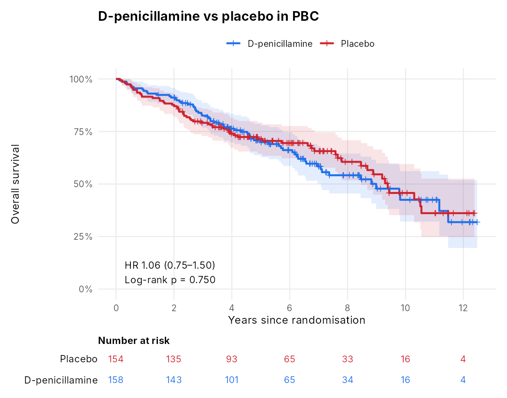
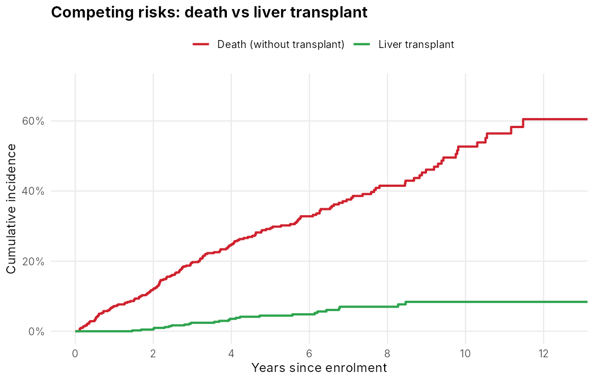
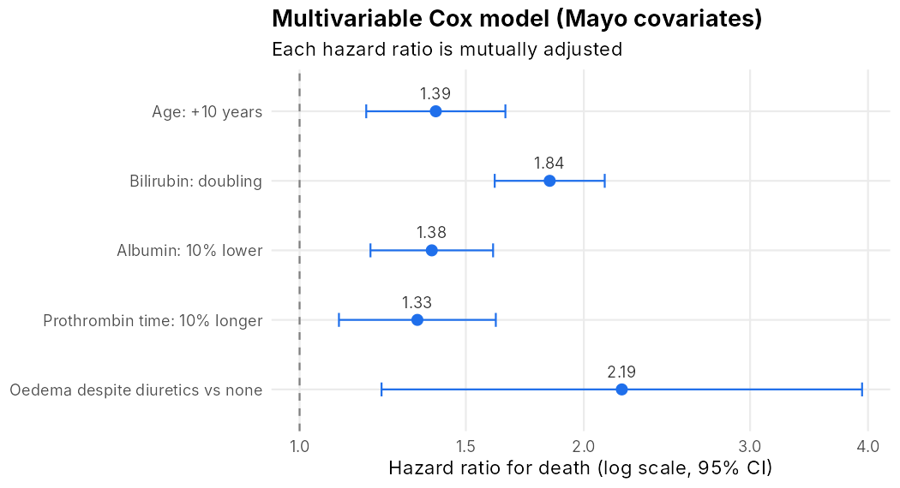
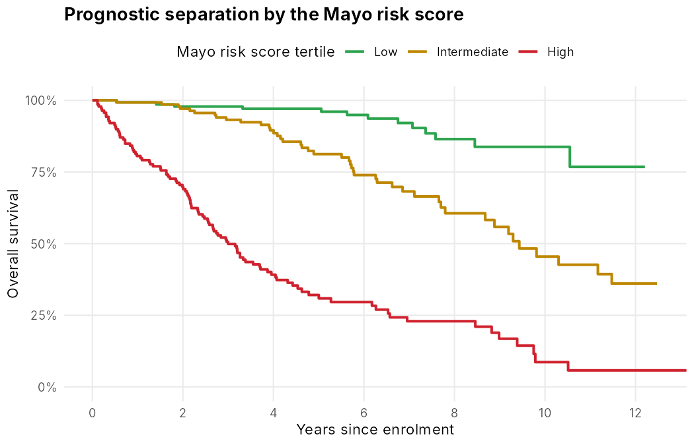

# Survival Analysis in Primary Biliary Cholangitis (Mayo Clinic Trial)


A reproducible time-to-event analysis in R of the landmark Mayo Clinic PBC cohort. The data come from a
randomised, placebo-controlled trial of D-penicillamine (1974–1984) plus a prospectively followed observational
cohort. The project answers two clinical questions:

1. **Does D-penicillamine prolong survival in PBC?** (intention-to-treat analysis of the RCT)
2. **Can routine laboratory values predict prognosis?** I re-derive and validate the **Mayo risk score**,
   a classic prognostic model in hepatology that was historically used to time liver transplantation.

## Data

`survival::pbc` contains 418 patients with PBC, including 312 randomised to D-penicillamine or placebo and 106
eligible patients who consented only to follow-up. Outcomes are death, liver transplantation, or censoring.
The dataset ships with R's `survival` package and is fully de-identified. No data download is needed.

## Methods

| Question | Method |
|---|---|
| Treatment effect | Kaplan–Meier, log-rank test, Cox proportional hazards (ITT, n = 312) |
| Death vs transplant | Competing-risks cumulative incidence (Aalen–Johansen estimator) |
| Prognostic model | Multivariable Cox model with the Mayo covariates: age, log bilirubin, log albumin, log prothrombin time, oedema |
| Model assumptions | Scaled Schoenfeld residuals (`cox.zph`) |
| Validation | Published Mayo score applied to the 106 non-randomised patients (Harrell's C) |
| Risk stratification | KM survival by tertile of the Mayo score |

## Key results

**1. D-penicillamine does not improve survival.** HR for death 1.06 (95% CI 0.75–1.50), log-rank p = 0.75.
Median survival was 9.0 vs 9.4 years. This reproduces the original trial's null result, and D-penicillamine
is no longer used for PBC.

<p align="center"></p>

**2. Liver transplant is a competing event.** At 10 years, the cumulative incidence was 52.7% for death without
transplant and 8.4% for transplant. Ignoring the competing risk would bias mortality estimates.

<p align="center"></p>

**3. The Mayo model is reproducible and well-discriminating.** Re-estimated coefficients are close to the
published ones (Dickson et al., 1989). Bilirubin, the strongest predictor, has a coefficient of 0.880 here vs
0.871 published. Apparent C-index is 0.844. Applied unchanged to the 104 non-randomised patients with
complete data, the **published score achieved C = 0.79 (95% CI 0.72–0.86)**.

| Clinical contrast (mutually adjusted) | HR for death (95% CI) |
|---|---|
| Age +10 years | 1.39 (1.18–1.65) |
| Bilirubin doubling | 1.84 (1.61–2.10) |
| Albumin 10% lower | 1.38 (1.19–1.60) |
| Prothrombin time 10% longer | 1.33 (1.10–1.61) |
| Oedema despite diuretics vs none | 2.19 (1.22–3.94) |

<p align="center">
  
  
</p>

**4. Strong risk separation.** Five-year survival was 97% in the lowest Mayo-score tertile, 81% in the middle
tertile and 32% in the highest.

**5. Assumption check.** The global proportional-hazards test was p = 0.061. Prothrombin time (p = 0.02) and oedema
(p = 0.04) show some early-follow-up time-dependence ([figure](figures/schoenfeld_residuals.png)). Their prognostic
effect is strongest soon after enrolment, an honest caveat for a long-horizon model.

Full tables: [`results/results.md`](results/results.md).

## Limitations

* The data are from 1974–1984, before ursodeoxycholic acid (UDCA) became first-line therapy. Absolute survival
  today is much better, and modern scores (GLOBE, UK-PBC) are calibrated to UDCA-treated patients.
* Validation is on a small, non-randomised sample from the same centre and era. This is temporal and
  selection-based, not truly external.
* For research and teaching only. **Not for clinical decision-making.**

## Reproduce

```bash
git clone https://github.com/alirezajavan-sys/pbc-survival-analysis.git
cd pbc-survival-analysis
Rscript install.R            # installs survival, ggplot2, patchwork, knitr, scales, testthat
Rscript analysis.R           # regenerates results/ and figures/ (< 30 s)
Rscript -e 'testthat::test_dir("tests/testthat")'
```

## Repository structure

```
├── R/functions.R                 # Mayo score, data prep, tidy KM helpers (unit-tested)
├── analysis.R                    # full analysis: tables + figures
├── results/                      # results.md, CSV tables
├── figures/                      # PNG figures
└── tests/testthat/               # testthat unit tests
```

## References

* Dickson ER, Grambsch PM, Fleming TR, Fisher LD, Langworthy A. Prognosis in primary biliary cirrhosis:
  model for decision making. *Hepatology.* 1989;10(1):1–7.
* Fleming TR, Harrington DP. *Counting Processes and Survival Analysis.* Wiley; 1991 (Appendix D: PBC data).
* Therneau TM, Grambsch PM. *Modeling Survival Data: Extending the Cox Model.* Springer; 2000.

## Author

**Alireza Javan**. [GitHub profile](https://github.com/alirezajavan-sys)
